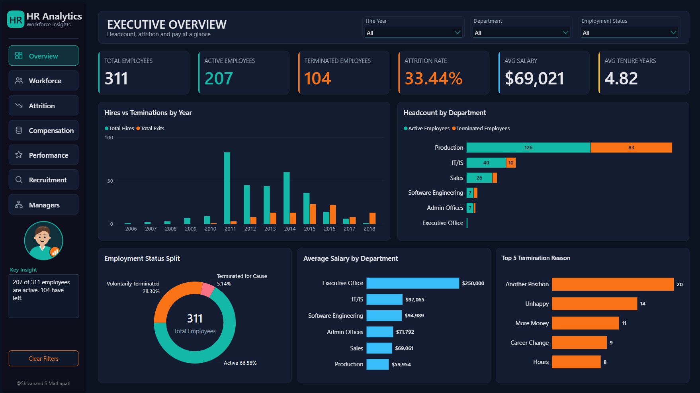
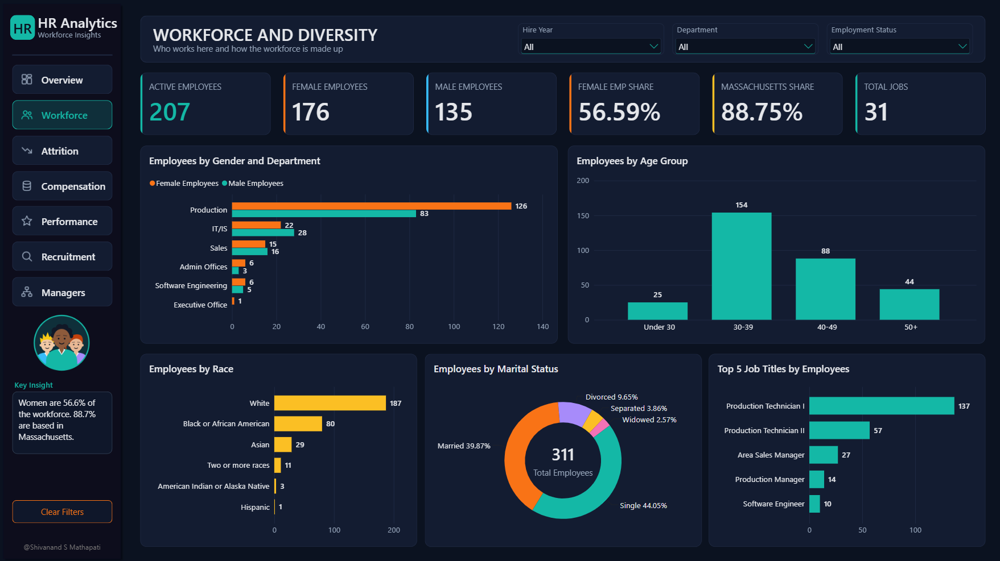
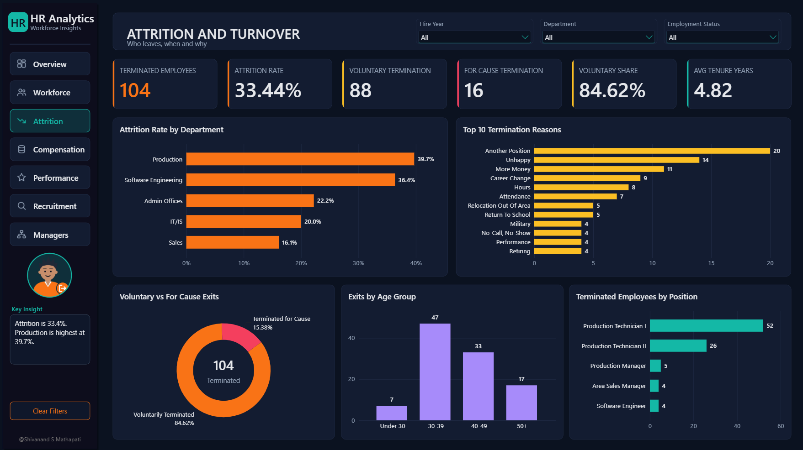
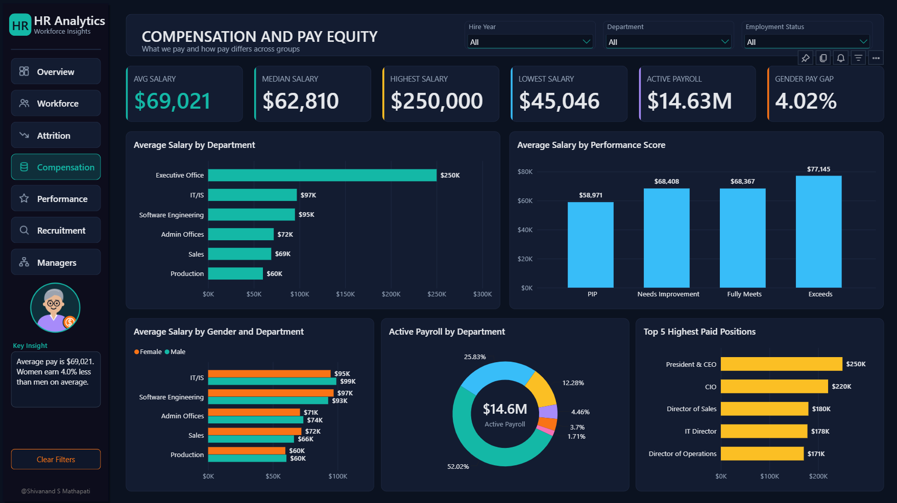
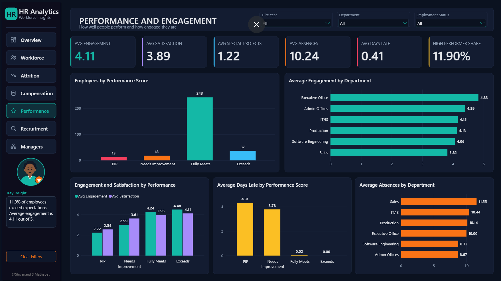
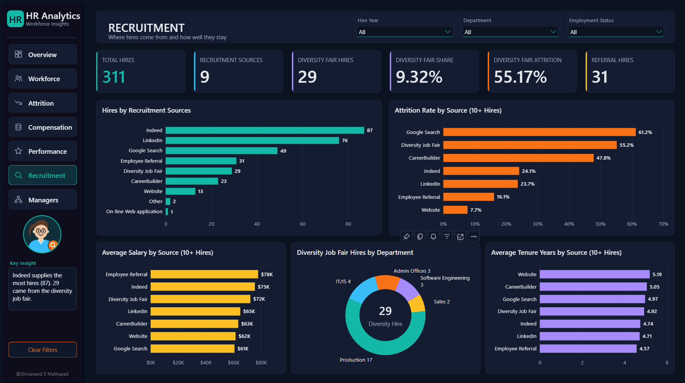
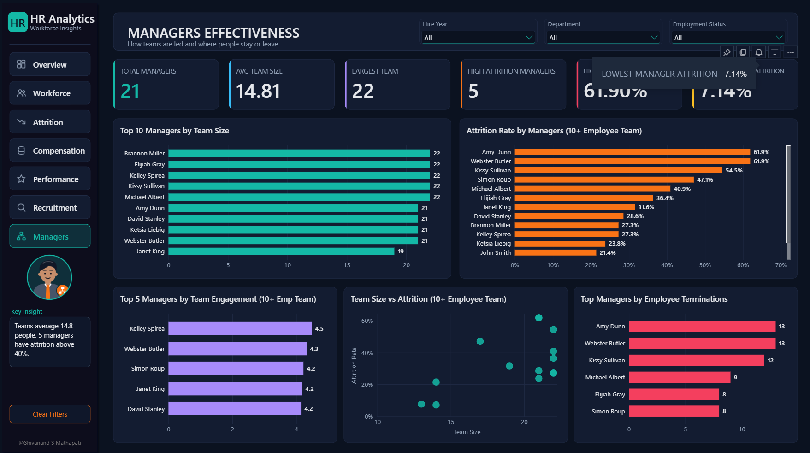
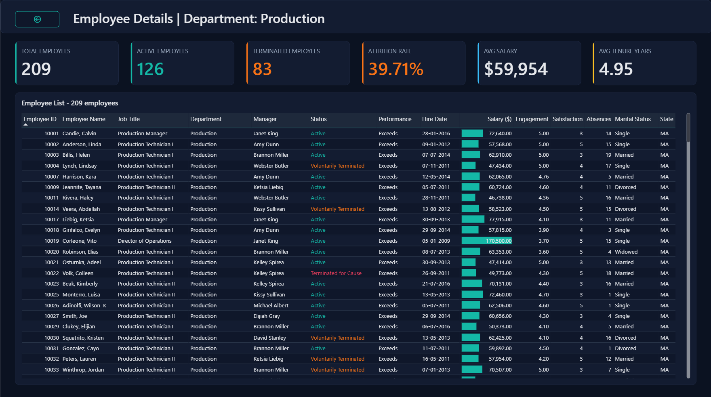
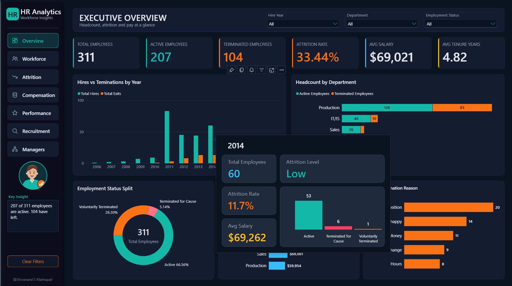

<div align="center">
  
# 👥 HR Analytics: Employee Attrition, Workforce & Compensation Analysis

   ### SQL Server + Power BI

   End-to-end pipeline: raw HR CSV → cleaned star schema → 11 analysis views → one-page, 7-section Power BI dashboard

[](https://www.microsoft.com/en-us/sql-server) [](#-power-bi-dashboard) [](#-reporting-layer) [](#%EF%B8%8F-data-model) [](#)

</div>

---

## 📑 Table of Contents

- [Overview](#-overview)
- [Dashboard Preview](#%EF%B8%8F-dashboard-preview)
- [Key Features](#-key-features)
- [Data Model](#%EF%B8%8F-data-model)
- [Data Cleaning](#-data-cleaning)
- [Reporting Layer](#-reporting-layer)
- [Power BI Dashboard](#-power-bi-dashboard)
- [Tech Stack](#%EF%B8%8F-tech-stack)
- [Repository Structure](#-repository-structure)
- [How to Use](#-how-to-use)
- [Key Findings](#-key-findings)
- [Root Causes](#-root-causes)
- [Business Insights](#-business-insights)
- [Recommendations & Actions](#-recommendations--actions)
- [Related Projects](#-related-projects)
- [Author](#-author)
- [License](#-license)

---

## 📌 Overview

This project analyses the Kaggle **Human Resources Data Set (HRDataset_v14)** from raw CSV to a finished dashboard. The data is cleaned and modelled in **Microsoft SQL Server (T-SQL)**, tested with section-wise analysis views and stored procedures, and then served to a **one-page, seven-section Power BI dashboard** built with DAX, bookmarks, drill-through and a custom tooltip.

Every cleaning decision is backed by a check query run before and after, so no row is lost silently. The SQL results were also used as a cross-check for every DAX measure in Power BI.

|  |  |
| --- | --- |
| 🗂️ **Raw records** | 311 employees, 36 columns |
| 🧑‍💼 **Employees** | 207 active, 104 terminated (88 voluntary, 16 for cause) |
| 📉 **Attrition rate** | 33.44% |
| 💰 **Average salary** | $69,021 (median $62,810) |
| 🏢 **Departments** | 6 |
| 👔 **Job titles / Managers** | 31 / 21 |
| 📅 **Time range** | Hires 2006 – 2018, data up to 28 Feb 2019 |
| 🗄️ **Database** | `HRAnalyticsDB`, 3 schemas (`original`, `datamodel`, `reporting`) |
| 📊 **Reporting objects** | 11 section views + 3 stored procedures + 10 Power BI feed views |

---

## 🖼️ Dashboard Preview

| Executive Summary | Workforce & Diversity |
|---|---|
|  |  |
| **Attrition** | **Compensation** |
|  |  |
| **Performance & Engagement** | **Recruitment** |
|  |  |
| **Managers** | **Drill-through: Employee Detail** |
|  |  |
| **Custom Tooltip** |
|  |

---

## ✨ Key Features

- **Full ETL pipeline in T-SQL** — raw import → validation → cleaning → star schema, with every step counted and verified (311 rows in, 311 rows out)
- **A defensive 3-schema design** — `original` (raw data, never edited), `datamodel` (trusted star schema), `reporting` (views and procedures for analysis and Power BI)
- **Validation before cleaning** — hidden spaces, letter-case variants, stray manager IDs, ID-vs-text mismatches, date-order errors and type-conversion tests, all logged in an issue log with a planned fix for each
- **11 section views, each with standalone queries** — workforce, geography, attrition, hiring and tenure, compensation, performance, engagement, attendance, recruitment, diversity and manager effectiveness
- **A recursive-CTE date dimension** — `Dim_Date` built entirely in SQL (5,113 days, 2006–2019)
- **A one-page Power BI dashboard** — 7 sections switched with bookmarks, a highlighted sidebar, 3 shared slicers and a clear-filters button
- **Drill-through, custom tooltip and dynamic text** — an Employee Detail page, a report-page tooltip, and a "Key insight" box that changes per section through DAX
- **A reference date instead of today** — tenure and age are measured to the latest review date in the data (28 Feb 2019), so results do not drift over time

---

## 🗃️ Data Model

A star schema with one fact table and nine dimension tables, built with `SELECT ... INTO` / `CREATE TABLE` and enforced with primary and foreign keys.

| Table | Type | Description |
| --- | --- | --- |
| **datamodel.Fact_Employment** | Fact | 311 rows — one per employee: keys to every dimension, hire / termination / last-review dates, salary, engagement, satisfaction, special projects, days late, absences, `Termd`, `ReviewDateIssue` |
| **datamodel.Dim_Employee** | Dimension | 311 rows — personal details: gender, marital status, citizenship, race, Hispanic flag, state, zip (kept as text), date of birth |
| **datamodel.Dim_Department** | Dimension | 6 rows — explicit keys 1 to 6 |
| **datamodel.Dim_Position** | Dimension | 31 rows — each position carries its `DepartmentID` |
| **datamodel.Dim_Manager** | Dimension | 21 rows — one cleaned ID per manager |
| **datamodel.Dim_RecruitmentSource** | Dimension | 9 rows |
| **datamodel.Dim_PerformanceScore** | Dimension | 4 rows — IDs double as the sort order (PIP → Exceeds) |
| **datamodel.Dim_EmploymentStatus** | Dimension | 3 rows |
| **datamodel.Dim_TermReason** | Dimension | 18 rows |
| **datamodel.Dim_Date** | Dimension | 5,113 rows (2006-01-01 to 2019-12-31), generated via a recursive CTE |

`datamodel.EmployeeClean` (311 typed rows) is the clean staging table the model is built from.

**Relationships in Power BI:** each dimension joins `Fact Employment` one-to-many. `Date` has one **active** relationship (hire date) and two **inactive** ones (termination date, last review date) used inside measures with `USERELATIONSHIP`.

**Computed label columns on the fact table:** `EmpCurrentStatus` (Active / Terminated), `DiversityJobFairHire` (Yes / No) and `ReviewDateIssueFlag` (Yes / No) — computed, so they can never disagree with the original 0/1 flags.

---

## 🔄 Data Cleaning

- Raw CSV imported with **every column as `nvarchar(100)`**, so nothing breaks or changes on import (for example zip `01960` stays `01960`)
- Worked on a **copy** (`original.hrdataclean`) — the raw table stays untouched
- Found hidden trailing spaces with `DATALENGTH` (the first check with `LEN` gave a false 0): `Employee_Name` 70 rows, `Sex` 135, `Department` 209, `Position` 1 — fixed with `TRIM`
- Standardised `HispanicLatino` from 4 variants (`Yes`, `yes`, `No`, `no`) to `Yes` / `No`
- Fixed manager IDs: 2 stray IDs (3 and 30) replaced with the manager's main ID (1 and 22); 8 blank IDs filled with 39 (Webster Butler) using a `ManagerMain` CTE joined on the manager name
- Converted types with `TRY_CAST` / `TRY_CONVERT` (salary to `DECIMAL(10,2)`, dates to `DATE`) after proving 0 conversion failures; blank termination dates became `NULL`
- Dropped the unreliable dataset IDs (`DeptID`, `PerfScoreID`, `EmpStatusID` each mismatch the text on 2 rows) and built own surrogate keys from the text columns
- Kept 2 employees whose review date is earlier than their hire date and added a `ReviewDateIssue` flag instead of guessing a correction
- Verified termination logic: `Termd`, status, termination date and reason agree for all 311 rows (207 / 88 / 16)
- Reconciled `Fact_Employment` with `EmployeeClean`: 311 rows, salary total 21,465,433, 104 terminated, 3,184 absences, 379 projects

---

## 📊 Reporting Layer

11 analysis views, 3 stored procedures and 10 Power BI feed views under the `reporting` schema:

| Section | View |
| --- | --- |
| **Workforce overview** | `vw_Workforce_Overview` |
| **Geography** | `vw_Geographical_Analysis` |
| **Attrition** | `vw_Attrition_Analysis` |
| **Hiring & tenure** | `vw_Hiring_Tenure_Analysis` |
| **Compensation & pay equity** | `vw_Compensation_Analysis` |
| **Performance** | `vw_Performance_Analysis` |
| **Engagement** | `vw_Engagement_Analysis` |
| **Attendance** | `vw_Attendance_Analysis` |
| **Recruitment** | `vw_Recruitment_Analysis` |
| **Diversity** | `vw_Diversity_Analysis` |
| **Manager effectiveness** | `vw_Manager_Analysis` |

**Stored procedures:**

```sql
EXEC reporting.usp_Attrition_Details;                          -- all terminated employees
EXEC reporting.usp_Attrition_Details @Department = 'Production';
EXEC reporting.usp_Termination_by_Year @Year = 2015;           -- exits in one year
EXEC reporting.usp_Employee_Profile_Check @EmpID = 10142;      -- one employee's full profile
```

**Power BI feed views:** `vw_Fact_Employment`, `vw_Dim_Department`, `vw_Dim_Position`, `vw_Dim_Manager`, `vw_Dim_RecruitmentSource`, `vw_Dim_PerformanceScore`, `vw_Dim_EmploymentStatus`, `vw_Dim_TermReason`, `vw_Dim_Employee`, `vw_Dim_Date` — readable column names, no raw personal details exposed.

---

## 📈 Power BI Dashboard

One page (1920 × 1080) with seven sections, switched through bookmarks and a sidebar:

| # | Section | What it answers |
| --- | --- | --- |
| 01 | Executive Summary | Headcount, attrition, tenure, exits, workforce mix |
| 02 | Workforce & Diversity | Gender, race, marital status, age groups, state, job titles |
| 03 | Attrition | Exits by year, reason, department; voluntary vs for cause |
| 04 | Compensation | Salary bands, gender pay gap, pay by department |
| 05 | Performance & Engagement | Score mix, engagement, satisfaction, absences, lateness |
| 06 | Recruitment | Hires and attrition by source |
| 07 | Managers | Team size, exits and attrition per manager |

**Design:** dark navy background with teal and orange accents, Segoe UI font, left sidebar with 14 custom SVG icons, three shared slicers (Hire Year, Department, Employment Status).

**Extra features:**
- 7 bookmarks (Display only) plus teal "selected" button copies to show the open section
- Clear-filters button and a Reset Filters bookmark
- Drill-through page **Employee Detail** (data bars and status colour rules)
- Custom report-page tooltip with status card and mini chart
- Sidebar avatar panel with a dynamic **Key insight** text per section
- Around 50 DAX measures in a `_Measures` table (headcount, attrition, tenure, median salary, gender pay gap, high-performer share, manager attrition and more)

---

## 🛠️ Tech Stack

| Tool | Purpose |
| --- | --- |
| **Microsoft SQL Server** | Database engine, T-SQL |
| **T-SQL features** | `TRY_CAST`, `TRY_CONVERT`, CTEs, window functions, recursive CTE, computed columns, `CREATE OR ALTER VIEW / PROCEDURE` |
| **Power BI Desktop** | Data model, DAX, bookmarks, drill-through, custom tooltip |
| **Excel** | First look at the data and column understanding |
| **CSV (Kaggle HR Data Set)** | Source dataset |

---

## 📁 Repository Structure

```
HR-Analytics-SQL-PowerBI/
│
├── 01_Raw_Data/
│   └── HRDataset_v14.csv
├── 02_Data_Dictionary/
├── 03_SQL/                     # import, validation, cleaning, model, views, procedures
├── 04_PowerBI/
│   ├── HR_Analytics_Dashboard.pbix
│   ├── Theme/
│   └── Assets/                 # 14 icons, 7 avatars
├── 05_Screenshots/             # images used in this README
├── 06_Documentation/           # project report (.docx)
└── README.md
```

---

## 🚀 How to Use

1. Create the database `HRAnalyticsDB` and the schemas `original`, `datamodel` and `reporting`
2. Import `HRDataset_v14.csv` with SSMS **Import Flat File** (all columns `nvarchar(100)`) into `original.HRDataset_v14`
3. Run the scripts in `03_SQL` from top to bottom: copy → validation → cleaning → dimensions → fact → analysis views → procedures → Power BI feed views
4. Open `HR_Analytics_Dashboard.pbix` in Power BI Desktop, change the SQL Server name in the data source, and refresh
5. Query any `reporting.*` view or call the stored procedures to explore the analysis in SQL

---

## 🧩 Key Findings

- **Attrition is 33.44%** (104 of 311 employees), and **84.6% of exits are voluntary** (88 voluntary, 16 for cause)
- **Production holds 209 employees, has 39.7% attrition and carries about 52% of active payroll**; most exits are Production Technician I (52) and II (26)
- **Top exit reasons:** another position (20), unhappy (14), more money (11), career change (9), hours (8)
- **Women earn about 4% less on average** (4.02% gap: $67,787 vs $70,629); the gap changes direction in some departments
- **Hiring source quality differs a lot** (sources with 10+ hires): Google Search 61.2% attrition, Diversity Job Fair 55.2%, CareerBuilder 47.8% vs Employee Referral 16.1%, LinkedIn 23.7% and Website 7.7%
- **5 managers have attrition above 40%**; the highest is 61.9% (Amy Dunn and Webster Butler, teams of 21)
- **Only 11.9% of employees exceed expectations**, and late days rise sharply for PIP (4.31) and Needs Improvement (3.78) staff, against 0.02 for Fully Meets

## 🔍 Root Causes

- **Attrition is concentrated, not company-wide** — Production Technician roles and a few managers' teams account for most exits
- **Source of hire affects retention** — referral and LinkedIn hires stay far longer than Google Search and CareerBuilder hires
- **Departure reasons point to career and pay, not for-cause actions** — most exits are voluntary, and "another position" and "more money" lead the reasons
- **Small groups can mislead** — the Executive Office has one employee and some sources have only 1 to 2 hires, so extreme percentages there are sample-size effects (the dashboard uses minimum-size filters)

## 💡 Business Insights

- Retention work should focus on **Production**, where volume and attrition are both highest
- **Employee referrals are the best recruiting channel** on retention, with 16.1% attrition and 31 hires
- **Manager teams differ widely** (7.14% to 61.9% attrition among teams of 10+), so manager quality is worth a closer look
- **Lateness is a strong early warning sign** — it is close to zero for good performers and high for PIP / Needs Improvement staff
- **Pay differences exist but are small overall** — the gender gap is 4.02% and varies by position

## ✅ Recommendations & Actions

| # | Recommendation |
| --- | --- |
| 1 | Run a retention review for Production Technician I and II roles (pay, hours, career path) |
| 2 | Shift hiring effort toward employee referrals and LinkedIn; review Google Search and CareerBuilder spend |
| 3 | Review the 5 managers with attrition above 40% and share practices from the lowest-attrition managers |
| 4 | Add exit-interview follow-up for "another position" and "more money" leavers |
| 5 | Review pay by position to confirm where the gender gap is real |
| 6 | Use days-late as a trigger for early check-ins with employees |
| 7 | Correct the 2 records with a review date before the hire date at the source system |

> The data is a public teaching dataset, so these conclusions illustrate the method and are not claims about a real company.

---

## 🔗 Related Projects

| Project | Tool | Link |
| --- | --- | --- |
| 🗄️ Customer Segmentation using RFM | SQL Server | *\[Add link here\]* |
| 📊 Superstore Sales Analysis | Power BI | [github.com/shivanand-Mathapati-Analyst/powerbi-sales-analysis-project](https://github.com/shivanand-Mathapati-Analyst/powerbi-sales-analysis-project) |
| 🗄️ Superstore Sales Analysis | SQL Server | [github.com/shivanand-Mathapati-Analyst/sql-superstore-sales-analysis](https://github.com/shivanand-Mathapati-Analyst/sql-superstore-sales-analysis) |
| 📗 Superstore Sales Analysis | Excel | [github.com/shivanand-Mathapati-Analyst/excel-superstore-sales-analysis](https://github.com/shivanand-Mathapati-Analyst/excel-superstore-sales-analysis) |

---

## 👤 Author

**Shivanand S. Mathapati**

- 🌐 Portfolio: [shivanand-mathapati.vercel.app](https://shivanand-mathapati.vercel.app)
- 🐙 GitHub: [shivanand-Mathapati-Analyst](https://github.com/shivanand-Mathapati-Analyst)
- 💼 LinkedIn: *\[Add link here\]*
- 📺 YouTube: *\[Add link here\]*
- ✉️ Email: plotforge64@gmail.com

---

## 📄 License

This project is licensed under the **MIT License** — feel free to use the schema design and query patterns for your own learning or portfolio projects. See [LICENSE](LICENSE) for details.

---

⭐ **If you found this project useful, consider giving it a star!** ⭐
